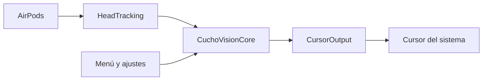

# CuchoVision

Mouse sin manos para la Mac. Esta versión (0.1) mueve el cursor con la cabeza usando AirPods. El seguimiento con la cámara y los clicks con el Apple Watch vienen después.

Hands-free mouse for the Mac. This version moves the cursor with your head via AirPods. Eye tracking and Apple Watch clicks come later. A short English section is at the bottom.

## Qué es

CuchoVision corre todo en tu Mac. No manda video ni movimiento a ningún servidor. Es código abierto, licencia MIT.

Trabaja por niveles. Solo el primero está armado:

| Nivel | Hardware | Estado |
|---|---|---|
| **1 — Cabeza** | AirPods con head tracking | Esta versión. Girá la cabeza y el cursor se mueve. |
| **2 — Ojos** | Cámara de la Mac | Más adelante. |
| **3 — Watch** | Apple Watch | Al final. Clicks, click derecho, arrastre y scroll. |

Sirve con AirPods que tengan *dynamic head tracking*: AirPods Pro, AirPods Pro 2, AirPods Max, AirPods 3 y AirPods 4. Los AirPods 2 y los EarPods no sirven.

## Cómo correrlo en Xcode

Nacho: no hace falta saber Swift para probarlo. Seguí estos pasos en la Mac (macOS 14 Sonoma o más nuevo).

1. Instalá **Xcode** desde la App Store. Es gratis y pesado. La primera vez que lo abras va a instalar componentes extra: esperá a que termine.
2. Bajá el proyecto. Si ya lo tenés en una carpeta, salteá esto. Si no, abrí **Terminal** (Spotlight, escribí Terminal, Enter) y pegá:

   ```bash
   git clone https://github.com/NatxioDev/CuchoVision.git
   cd CuchoVision
   ```

3. En el Finder, entrá a esa carpeta y hacé **doble clic** en el archivo azul `CuchoVision.xcodeproj`. Se abre Xcode. No abras `Package.swift` para correr la app: ese archivo es la librería; el proyecto azul es la app.
4. Arriba, al lado del botón de play, tiene que decir **CuchoVision** y **My Mac**. Si dice un iPhone, hacé clic y elegí **My Mac**.
5. Si Xcode muestra un error rojo de firma (*Signing requires a development team*):
   - En la columna de la izquierda, hacé clic en el ícono azul **CuchoVision**.
   - En *TARGETS*, elegí **CuchoVision**.
   - Pestaña **Signing & Capabilities**.
   - Marcá **Automatically manage signing**.
   - En *Team*, elegí tu Apple ID. Si no aparece, *Add an Account…* con el Apple ID de siempre (el Personal Team es gratis).
6. Apretá el triángulo **▶** (o la tecla **⌘R**). Abajo va a decir *Building*. La primera vez tarda un poco. Cuando diga *Build Succeeded* y el botón pase a un cuadrado, la app ya está corriendo.
7. **No va a aparecer una ventana ni un ícono en el Dock.** Es una app de la barra de menú. Mirá arriba a la derecha, al lado del reloj. El ícono es unos AirPods, un triángulo de advertencia (todavía falta un permiso) o un círculo de pausa. Si la barra está llena, pasá el mouse por el centro de la pantalla: a veces el notch lo tapa.
8. macOS va a preguntar si CuchoVision puede usar el movimiento. Aceptá.
9. Ponete los AirPods, mirá de frente a la pantalla y, en el menú de CuchoVision, tocá **Recentrar (⌥⌘R)**.
10. Girá la cabeza despacio. El cursor se tiene que ir para ese lado. Para frenar, dejá la cabeza en el centro otra vez, o pausá con **⌥⌘P**.
11. Para parar la app: en el menú de CuchoVision elegí **Salir de CuchoVision**, o en Xcode apretá el cuadrado **■** (Stop).

Si volvés a apretar ▶ y Xcode dice que la app ya está corriendo, primero dale a Salir o al cuadrado.

## Permisos

Sin estos dos permisos no se mueve nada. El de movimiento, si falta, la app puede directamente fallar al arrancar el sensor: por eso `NSMotionUsageDescription` está en `Apps/CuchoVisionMac/Info.plist`. El de Accesibilidad, si falta, no tira un error: macOS tira los eventos del mouse a la basura y el cursor queda quieto.

**Movimiento.** Lo pide macOS la primera vez. Si le diste que no:

```bash
tccutil reset Motion com.natxiodev.cuchovision
```

Cerrá la app, corré eso en Terminal y volvé a abrirla.

**Accesibilidad.** En el menú de CuchoVision: **Pedir permiso de Accesibilidad** y después **Abrir Ajustes del Sistema**. El camino a mano es Ajustes del Sistema → Privacidad y seguridad → Accesibilidad → activalo para **CuchoVision**. Si el interruptor no hace nada, o ves dos CuchoVision, resetear el permiso:

```bash
tccutil reset Accessibility com.natxiodev.cuchovision
```

Eso pasa seguido si un día lo corrés desde Xcode y otro día desde una app exportada: macOS los trata como programas distintos aunque el identificador sea el mismo (`com.natxiodev.cuchovision`).

Los atajos globales (⌥⌘R y ⌥⌘P) también necesitan Accesibilidad. Sin ese permiso, los botones del menú siguen andando.

## Cómo se usa

La cabeza funciona como un joystick, no como un mapa de la pantalla. El centro es “la cabeza quieta, el cursor quieto”. Si girás y te quedás ahí, el cursor sigue viajando. Volvé al centro para frenar.

| Acción | Cómo |
|---|---|
| Mover el cursor | Girar la cabeza. Horizontal es yaw, vertical es pitch. |
| Frenar | Volver la cabeza al centro. |
| Recentrar | **⌥⌘R** o **Recentrar** en el menú. Hacelo mirando al frente. |
| Pausar / reanudar | **⌥⌘P** o el botón del menú. Al reanudar, la pose actual pasa a ser el centro para que el cursor no salga disparado. |
| Velocidad, zona muerta, aceleración, invertir ejes | **Ajustes…** en el menú. Se guardan solos. |

La zona muerta es un ángulo chico alrededor del centro donde el temblor no mueve el cursor. La aceleración hace que un giro grande recorra más pantalla que uno chico. El suavizado es un filtro One Euro: aplasta el ruido y deja pasar el movimiento.

Si al mirar a la derecha el cursor va a la izquierda, en Ajustes activá **Invertir horizontal**. Si al mirar arriba el cursor baja, activá **Invertir vertical**.

Varios monitores: el cursor puede cruzar de una pantalla a la otra. No se va más allá del rectángulo que envuelve a todas (incluye monitores a la izquierda o arriba del principal, que tienen coordenadas negativas).

## Si algo no anda

- **El ícono no aparece.** Fijate al lado del reloj y debajo del notch. En Xcode, el cuadrado tiene que estar visible (la app está corriendo). Si el build falló, el error está en el panel de abajo; la línea roja dice el archivo.
- **Build falló con “No such module”.** Menú File → Packages → Resolve Package Versions, y otra vez ▶.
- **No se mueve el cursor y el menú dice que faltan AirPods.** Tienen que estar puestos, no en el estuche, y ser un modelo con head tracking. Sacátelos y ponételos de nuevo: la app se entera cuando se conectan.
- **Los números de yaw y pitch en Ajustes se mueven, pero el cursor no.** Falta Accesibilidad. El sensor anda; macOS está bloqueando el mouse.
- **Se mueve al revés.** Ajustes → Invertir horizontal o vertical. Después, Recentrar.
- **Tiembla mucho.** Subí un poco la zona muerta o bajá la suavidad (el corte mínimo del filtro).
- **Quiero ver el log.** Abrí la app Consola, buscá `cuchovision`. Ahí aparecen conexión y pausa, no cada frame.

## Cómo está armado el código

No hace falta tocar esto para usarlo. Sirve si más adelante querés cambiar un número o leer qué hace cada carpeta.

```text
Package.swift                  Librerías y tests (Swift Package)
CuchoVision.xcodeproj          La app que abrís en Xcode
Apps/CuchoVisionMac/           SwiftUI: menú, ajustes, atajos, permiso
Sources/CuchoVisionCore/       Matemática pura: filtro, zona muerta, aceleración, pantallas
Sources/HeadTracking/          CMHeadphoneMotionManager (los AirPods)
Sources/CursorOutput/          CGEvent para mover el cursor, y el chequeo de Accesibilidad
Tests/CuchoVisionCoreTests/    Pruebas de la matemática, sin hardware
.github/workflows/ci.yml       En GitHub: compila y corre los tests en una Mac
```

El camino de un frame es: AirPods → ángulo relativo al último recentrado → filtro One Euro → zona muerta → aceleración → sensibilidad × tiempo → se suma a la posición del cursor → se recorta a la unión de las pantallas → `CGEvent`.



La matemática no conoce AppKit ni CoreMotion, así que se puede testear sola. Los tests cubren el filtro One Euro, la zona muerta, la aceleración, el cuaternión, el recorte entre monitores y el mapeo yaw/pitch → delta.

Desde la carpeta del proyecto, en Terminal:

```bash
swift test
xcodebuild -project CuchoVision.xcodeproj -scheme CuchoVision -destination 'generic/platform=macOS' -configuration Debug CODE_SIGNING_ALLOWED=NO build
```

El mismo par de comandos corre en GitHub Actions (`.github/workflows/ci.yml`) en un runner `macos-latest`.

## Privacidad

El movimiento de la cabeza y, más adelante, la cámara se procesan en la Mac. Esta versión no abre la cámara ni habla con el Watch. No hay cuenta ni red.

## Qué viene después

Clicks por dwell, imán a botones, pausa automática al escribir, ojos con la cámara y un bridge para el Apple Watch. Nada de eso está en este build.

## English

CuchoVision is an MIT-licensed menu-bar app. Version 0.1 maps AirPods head pose to the pointer.

Requirements: macOS 14+, Xcode, and AirPods with dynamic head tracking (Pro, Pro 2, Max, 3, or 4).

Run it: open `CuchoVision.xcodeproj`, select the **CuchoVision** scheme and **My Mac**, press **Run** (⌘R). There is no Dock icon and no main window. Use the menu-bar item. Accept the Motion prompt, then enable **Accessibility** for `com.natxiodev.cuchovision` (the menu item can open System Settings). If permission sticks to the wrong binary:

```bash
tccutil reset Accessibility com.natxiodev.cuchovision
tccutil reset Motion com.natxiodev.cuchovision
```

Look straight ahead and choose **Recentrar** (⌥⌘R). Turning your head moves the cursor; returning to center stops it. **⌥⌘P** pauses. Settings cover speed, dead zone, acceleration, axis invert, and the One Euro filter. The cursor is clamped to the union of all displays.

`NSMotionUsageDescription` is in `Apps/CuchoVisionMac/Info.plist`. Without Accessibility, `CGEvent` mouse moves are dropped silently.

Layout: `CuchoVisionCore` (pure mapping and filters, XCTest), `HeadTracking` (`CMHeadphoneMotionManager`), `CursorOutput` (`CGEvent`), `Apps/CuchoVisionMac` (SwiftUI menu bar). CI runs `swift test` and `xcodebuild` on `macos-latest`. Camera eye tracking and Apple Watch clicks are not in this build.

## Licencia

[MIT](LICENSE) © 2026 Ignacio Paz
